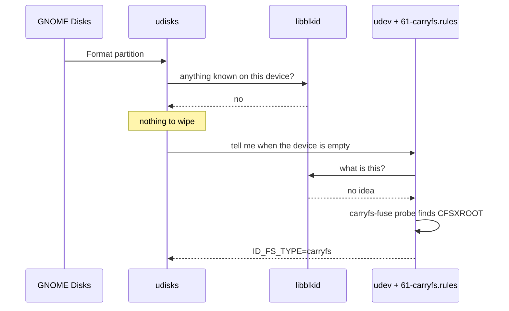
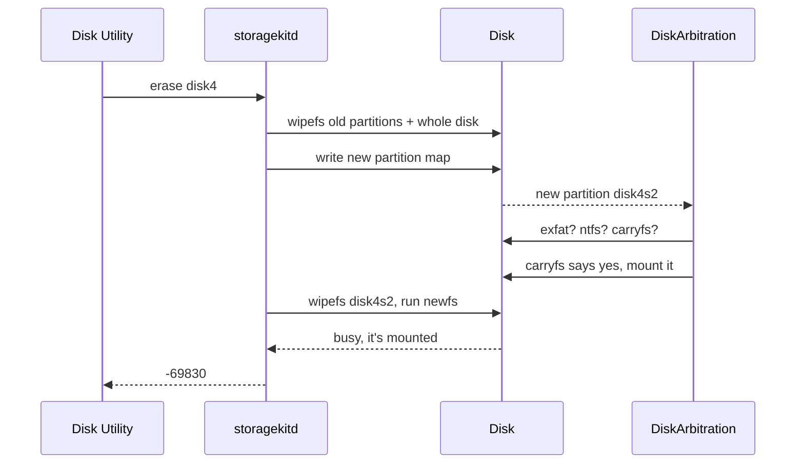
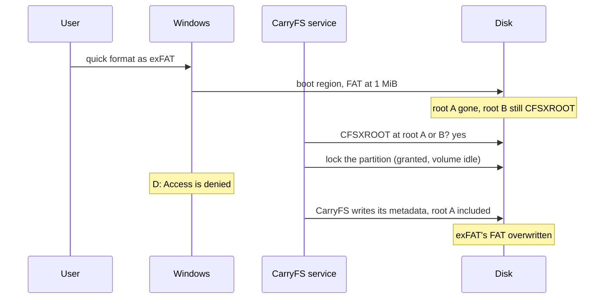

import Anatomy from "./_assets/press-format/anatomy.svg";
import Cast from "./_assets/press-format/cast.svg";
import Ghost from "./_assets/press-format/ghost.svg";
import GuestList from "./_assets/press-format/guest-list.svg";
import MacWipeMap from "./_assets/press-format/mac-wipe-map.svg";
import MacRace from "./_assets/press-format/mac-race.svg";
import NearMiss from "./_assets/press-format/near-miss.svg";
import TwoLetters from "./_assets/press-format/two-letters.svg";
import WindowsPaint from "./_assets/press-format/windows-paint.svg";

Every operating system has a Format button. You pick a name and a filesystem, you click, and a few seconds later the drive is empty. Nobody thinks about those few seconds.

I didn't either. Then my filesystem kept surviving them.

[CarryFS](https://carryfs.com/) is a filesystem I've been building so one drive can move between a Mac, a Windows PC, and a Linux machine.
The code is open source and lives [on GitHub](https://github.com/carry-fs/carryfs), which is also where the issues I mention below are.
More on why at the end. For this story you only need to know that it's new.
No operating system ships with it, and none of them has heard of it.
To all three it's a stranger, and each one treats strangers badly in its own way.

- Linux checks its guest list, doesn't find the stranger, and walks past.
- macOS knocks the house down no matter who lives there. But first it rings the doorbell and asks if anyone's home.
- A Windows quick format paints its new filesystem over the front of the house. In my tests, the back was still standing. Then my own code let the stranger back in.

<figure>
  <div
    class="diagram-scroll"
    tabindex="0"
    role="region"
    aria-label="Diagram, scroll horizontally if needed"
  >
    <Cast
      role="img"
      aria-label="A house labelled CarryFS, with root A as a window at the front and root B at the back. A Linux doorman with a clipboard says not on my list. A Windows painter has painted over the front, covering root A. A macOS bulldozer asks anyone home? before flattening it."
    />
  </div>
  <figcaption>
    Three ways to greet a stranger. Root B, at the back, is the part that keeps
    coming back.
  </figcaption>
</figure>

## Table of contents

## Meet the stranger

Only two parts of CarryFS matter for this story.

The **roots** say where everything else is, like a table of contents. There are two copies of the last saved state, root A near the start of the partition and root B near the end. As long as the drive doesn't lie about having saved data, a crash in the middle of a write can't ruin both. Each root starts with 8 bytes of magic, `CFSXROOT`.

The **workspace banks** hold the list of spare blocks the next save will write into. There are two of them and they take turns. Each save fills the bank that isn't in use, then points the root at it.

All four live in a 2 MiB reserved band at each end of the partition, with room left over for future structures. Your files live in the middle.

<figure>
  <div
    class="diagram-scroll"
    tabindex="0"
    role="region"
    aria-label="Diagram, scroll horizontally if needed"
  >
    <Anatomy
      role="img"
      aria-label="A CarryFS partition. The first 2 MiB band holds bank A at 128 KiB and root A at 1 MiB. The last 2 MiB band holds root B at 1028 KiB before the end and bank B at 384 KiB before the end. Files live between the bands."
    />
  </div>
  <figcaption>
    A root and a bank at each end. Keep this picture in mind. It's the whole
    plot.
  </figcaption>
</figure>

CarryFS recognises itself in two ways, and both come back later. The quick check, `has_root_magic`, looks for `CFSXROOT` at root A or root B and nothing else. The full check, `Volume::open`, reads a root and then the bank it points to. If that bank is zeroed, the open fails.

## Linux, the doorman with a guest list

Press **Format** in GNOME Disks and the request goes to udisks. Before udisks creates the new filesystem, it asks libblockdev to clear whatever is on the device. The heart of that is this loop from [libblockdev 3.5.0](https://github.com/storaged-project/libblockdev/blob/3.5.0/src/plugins/fs/generic.c#L487-L497):

```c
while (all && (blkid_do_probe (probe) == 0)) {
	status = blkid_do_wipe (probe, FALSE);
	...
}
```

Each pass asks libblkid whether it recognises anything on the device. If it does, the loop zeroes those bytes and asks again. It stops when libblkid recognises nothing.

That's thorough, but only as thorough as libblkid's guest list. The list lives in [libblkid's source](https://github.com/util-linux/util-linux/blob/v2.42.3/libblkid/src/superblocks/superblocks.c#L95-L185), and in util-linux 2.42.3 it has 82 names. It has ext4, Btrfs, ZFS, and APFS. It has Xenix. It has NetWare. It has the filesystem from BeOS. I'd never heard of half of them. It still doesn't have CarryFS.

<figure>
  <div
    class="diagram-scroll"
    tabindex="0"
    role="region"
    aria-label="Diagram, scroll horizontally if needed"
  >
    <GuestList
      role="img"
      aria-label="libblkid's list of 82 filesystems includes ext4, Btrfs, ZFS, APFS, Xenix, NetWare, and BeFS, but not CarryFS. Its probe of a CarryFS device recognises nothing, so nothing gets wiped."
    />
  </div>
  <figcaption>Xenix gets in. CarryFS doesn't.</figcaption>
</figure>

So the loop finds nothing to wipe, wipes nothing, and udisks moves on. udisks doesn't erase the stranger. It doesn't even see it.

Other Linux tools are less picky. `dd` from `/dev/zero` overwrites a device without recognising anything on it, and `mke2fs` discards the whole device by default when the hardware supports it. But GNOME Disks never gets that far.

### And then I made it worse

Next, udisks waits for udev to confirm that the device is empty. udev asks libblkid, which still sees nothing. Then my own udev rule runs. It calls the CarryFS probe on every device libblkid couldn't name, so CarryFS drives show up on the desktop. The probe finds `CFSXROOT` at 1 MiB and tells udev the device holds CarryFS.

The probe is right. Nothing touched that block. The drive still holds CarryFS.



udisks is waiting for a device that will never be empty. After 20 seconds it gives up:

```
udisksd: Error synchronizing after initial wipe: Timed out waiting for object
```

The desktop mounts the CarryFS volume again, with every file still on it. In fairness to Linux, half of this one is on me. Linux walked past the stranger, and my udev rule stood in the doorway shouting that the stranger was still there. [Issue #7 in the CarryFS repo](https://github.com/carry-fs/carryfs/issues/7) has the full report if you're interested.

### A self-destruct button

udisks can't see CarryFS, so CarryFS brings its own eraser:

```sh
mkfs.carryfs --wipe /dev/sdX1
```

It zeroes both 2 MiB bands, which takes out both roots and both banks. After that, libblkid, the udev probe, and udisks all agree the device is empty, and GNOME Disks will format it as anything you like.

It refuses a mounted device, a whole disk that holds partitions, and anything without CarryFS root magic. That last check catches most typos, but not all of them. As the Windows section shows, a partition can carry a new filesystem on top of old roots, and if it isn't mounted, `--wipe` will erase that filesystem's first 2 MiB.

The proper fix is to get CarryFS onto the guest list, next to ZFS and Btrfs (and Xenix). Then the loop above would find it and wipe it like everyone else. Until that happens, [issue #7](https://github.com/carry-fs/carryfs/issues/7) stays open.

### The ghost in the walls

On a partitioned disk, `wipefs -a /dev/sdX` erases only the partition table. That's by design, and [its man page](https://man7.org/linux/man-pages/man8/wipefs.8.html) says so. It leaves the contents of every partition alone, whatever filesystem they hold. Repartitioning in GNOME Disks or parted does the same thing. The CarryFS volume is still on the disk, byte for byte, but nothing points to it anymore.

Call it a hidden volume. Any filesystem can end up hidden like this. macOS is where they come back to haunt you.

## macOS, the demolition crew

Apple went the opposite way. Apple's `wipefs`, in [libutil](https://github.com/apple-oss-distributions/libutil/blob/main/wipefs.cpp), doesn't ask what's on the device. It zeroes the same regions on every device it's given. Those are the first and last 2 MiB, 64 KiB around the middle for NTFS, the UDF anchor blocks, and the sectors that hold partition tables. A comment in the source explains the 2 MiB part, and I love it:

> we don't know what blocks future FS will use to recognize itself. But we'd better be safe than sorry and write the first and last 2MB of the volume

Somebody at Apple planned for CarryFS years before CarryFS existed. The first and last 2 MiB are exactly where it keeps its roots and banks.

<figure>
  <div
    class="diagram-scroll"
    tabindex="0"
    role="region"
    aria-label="Diagram, scroll horizontally if needed"
  >
    <MacWipeMap
      role="img"
      aria-label="Apple's wipefs zeroes the first 2 MiB, 64 KiB in the middle, and the last 2 MiB of every device. CarryFS keeps its roots and banks in the first and last 2 MiB, so they line up exactly."
    />
  </div>
  <figcaption>
    Apple erases by position, not by name. CarryFS sits right in the blast zone.
  </figcaption>
</figure>

Before it writes those zeros, `wipefs` also asks the device to unmap, or TRIM, all of its blocks. On my USB stick that made no visible difference, because the old roots outlived it. An SSD that acts on unmap may behave differently.

Every Apple formatter runs `wipefs` before it writes anything. That includes `newfs_msdos`, `newfs_exfat`, `newfs_hfs`, and `newfs_apfs`. So macOS erases CarryFS without ever learning its name. That's what the code is for.

Which is why I was surprised when Disk Utility refused to erase a stick. Here's the log, with the volume name changed:

```
Formatting disk4s2 as CarryFS with name CARRYFS
This operation requires an unmounted disk. : (-69830)
```

The cause is the order in which macOS does things.

### Ringing the doorbell

Disk Utility hands the erase to a system daemon, `storagekitd`. For a whole-disk erase, this is what happens:

1. `storagekitd` unmounts every volume on the disk.
2. It runs `wipefs` on every partition in the current table, and on the whole disk.
3. It writes the new partition map.
4. The kernel creates the new partition devices. DiskArbitration, the part of macOS that mounts drives, probes each one right away with every installed filesystem and mounts the first one that answers.
5. `storagekitd` runs `wipefs` on the new partitions, then the formatter.

If anything answered in step 4, step 5 finds a mounted partition and refuses with `-69830`.

Step 4 is the demolition crew ringing the doorbell of a house it's about to flatten. Usually nobody answers. But CarryFS registers its own probe, which runs after Apple's checks. If it says yes, DiskArbitration mounts the partition and the bulldozer stops at the front door.



I timed the gap. A script polled the new partition every 5 ms during an erase. The old data stayed readable for 480 to 650 ms after the partition appeared, until the wipe in step 5 reached it. For about half a second, macOS looks for a filesystem on a partition it's about to wipe.

<figure>
  <div
    class="diagram-scroll"
    tabindex="0"
    role="region"
    aria-label="Diagram, scroll horizontally if needed"
  >
    <MacRace
      role="img"
      aria-label="A timeline. At 0 ms the new partition appears. The old CarryFS volume stays readable until storagekitd's wipe arrives, 480 to 650 ms later. DiskArbitration probes and mounts it somewhere inside that window, so the wipe finds a mounted partition and the erase fails with -69830."
    />
  </div>
  <figcaption>Half a second is plenty of time to answer the door.</figcaption>
</figure>

### Why it usually works anyway

Step 2 wipes every partition in the current table. If the old CarryFS partition is in the table, it loses both bands before the new map exists, and nobody answers the doorbell. I erased CarryFS into exFAT, HFS+, and CarryFS again, on GPT and on MBR. Every erase worked.

The trouble is the hidden volume from the Linux section. The table doesn't mention it, so step 2 never wipes it. And in my tests, Disk Utility laid out a GPT disk the same way every time, with a 200 MiB EFI partition and then the data partition from 201 MiB to the end. If the hidden volume came from that same layout, the new partition lands exactly on top of it. Same start, same size, so the old roots sit exactly where CarryFS expects them, and the size recorded in them matches. The ghost fits the new house perfectly.

### Missed by 4 KiB

Step 2 also wipes the whole disk, which covers the disk's first and last 2 MiB. On my 62 GB Lexar stick, the data partition ends exactly 1 MiB before the end of the disk. So the whole-disk wipe reaches 1 MiB into the end of the partition.

Bank B, 384 KiB from the end of the partition, falls inside the wipe. Root B, 1028 KiB from the end, misses it by one block. That's 4 KiB. Root A and bank A sit 201 MiB into the disk, nowhere near either edge.

<figure>
  <div
    class="diagram-scroll"
    tabindex="0"
    role="region"
    aria-label="Diagram, scroll horizontally if needed"
  >
    <NearMiss
      role="img"
      aria-label="The last part of the disk. The whole-disk wipe covers the disk's last 2 MiB, which includes the 1 MiB after the partition and all 256 KiB of bank B. Root B, a single 4 KiB block, ends exactly where the wipe starts and survives."
    />
  </div>
  <figcaption>The whole-disk wipe stops one block short of root B.</figcaption>
</figure>

So both roots survive, and whether the ghost answers the door depends on which bank its root points to. The banks take turns, remember.

- If the root points at bank B, the probe follows it to a zeroed bank. The full check fails, nothing mounts, and the erase works.
- If the root points at bank A, everything the probe needs is intact. macOS mounts the volume it's in the middle of erasing, and the erase fails.

I built hidden volumes on purpose and erased them. Every bank-A volume came back, 3 out of 3. Bank-B volumes never did, in more than a dozen erases. So whether the erase works isn't luck. It depends on which bank the last save happened to use, and a used volume can be on either one. My sample was small, but no run broke that rule.

The workaround is almost silly: press Erase again. The failed erase leaves the revived partition in the table, so the second erase wipes it in step 2. [Issue #9](https://github.com/carry-fs/carryfs/issues/9) tracks a real fix. The idea there is to store the partition's GPT GUID in the root, so a probe can tell a leftover from a live volume. Getting CarryFS into libblkid wouldn't help here. It fixes the udisks failure from issue #7, but `wipefs -a` on a whole disk would still leave the partition's contents alone.

I haven't tested whether a hidden exFAT or APFS volume comes back the same way. It probably does, since step 4 doesn't care which filesystem answers.

## Windows, the painter

On Windows, nothing system-wide looks for CarryFS. My service does. It checks every partition of a disk when the disk arrives, and every disk when the service starts. If the quick check finds `CFSXROOT`, the service locks the partition for itself and mounts it through WinFsp. It doesn't watch Disk Management or diskpart, so the macOS race can't happen in the middle of an erase. It can happen at the next plug-in.

I tested on the same 62 GB Lexar stick, on Windows 10. Each run made a CarryFS partition, deleted it, created a partition of the same size in the same place, quick-formatted it, and copied a file onto it.

### Fresh paint on the front door

A Windows quick format doesn't wipe anything first. It writes the new filesystem's structures, mostly at the start of the partition. Root B, near the end, survived every quick format I tested. A full format is different, because it writes zeros over the whole partition, and a format on an SSD can also send TRIM. I only tested quick formats. Here's what the old roots looked like afterwards.

| New filesystem | Root A, 1 MiB in | Root B, end - 1028 KiB | `carryfs-windows probe`          |
| -------------- | ---------------- | ---------------------- | -------------------------------- |
| exFAT          | overwritten      | `CFSXROOT`             | `carryfs <uuid>`, opens cleanly  |
| NTFS           | overwritten      | `CFSXROOT`             | `carryfs damaged: page checksum` |
| FAT32          | overwritten      | `CFSXROOT`             | `carryfs damaged: page checksum` |

FAT32 ran on a 32,000 MiB partition, because the Windows 10 tools won't format FAT32 above 32 GB.

exFAT is the clearest case. On this partition, Windows put exFAT's allocation table, the FAT, exactly at 1 MiB, right where root A lives. The bytes there now read `f8 ff ff ff` instead of `CFSXROOT`. exFAT's data area starts at 3 MiB, and nothing got written near the end. Root B and everything it points to stayed whole, and the full check read the old volume through root B as if nothing had happened.

<figure>
  <div
    class="diagram-scroll"
    tabindex="0"
    role="region"
    aria-label="Diagram, scroll horizontally if needed"
  >
    <WindowsPaint
      role="img"
      aria-label="Before and after a quick format to exFAT. Before, the partition holds a complete CarryFS volume. After, exFAT's structures cover the first band and root A, but root B and bank B at the end are untouched."
    />
  </div>
  <figcaption>
    New paint on the front, the old house intact behind it.
  </figcaption>
</figure>

NTFS and FAT32 overwrote something root B needs, so the full check fails for them. I didn't track down which block. That's luck, not design.

### My service let the ghost back in

Here's the dangerous part. The quick check only asks whether `CFSXROOT` is there, and the service never checked whether Windows had already mounted a filesystem on the partition.

I thought the lock was a safety net. If Windows has exFAT mounted, surely it won't let another program lock the partition for itself? Turns out it will, as long as the volume is idle. On the first replug, the service's lock failed because Windows was still busy with the new volume. From a shell, the same lock on an idle volume worked every time I tried. And when the service started with the stick already plugged in, its scan found an idle volume too:

```
carryfs: \\.\Harddisk3Partition2: mounted F:
```

Now the stick had two drive letters for one partition. D: was exFAT. F: was the old CarryFS, with the file I'd left on it. While F: was mounted, every access to D: failed with `Access is denied`. After the eject, exFAT's file was gone, the volume label was garbage, and chkdsk reported a corrupt bitmap and upcase table. Root A said `CFSXROOT` again, written right over exFAT's FAT.

<figure>
  <div
    class="diagram-scroll"
    tabindex="0"
    role="region"
    aria-label="Diagram, scroll horizontally if needed"
  >
    <TwoLetters
      role="img"
      aria-label="One partition with two drive letters. D: is exFAT and F: is the old CarryFS. Both point at the same block 1 MiB into the partition, where exFAT keeps its FAT and CarryFS writes root A."
    />
  </div>
  <figcaption>
    Two drive letters, one partition, and one block both of them think they own.
  </figcaption>
</figure>



I ran the exFAT case a second time and wrote nothing to F:. Mounting and ejecting alone corrupted exFAT again. Once a volume passes the full check, a writable mount repairs any missing root before it accepts a single file operation. So the mount itself wrote root A back, right over exFAT's FAT. With NTFS and FAT32 the full check failed first, so nothing mounted and both filesystems survived.

### The volume that wouldn't stay dead

The same poor stick also showed how long a leftover can last. I made a CarryFS partition at 201 MiB. Then the stick went through all of this, in order:

1. `diskpart clean`.
2. An exFAT format of a partition that spanned the disk.
3. A whole-disk CarryFS format, like `mkfs.carryfs /dev/sdX` after `wipefs` on Linux.
4. Another `diskpart clean`.
5. A new layout like Disk Utility's, with an EFI partition and exFAT from 201 MiB to the end.

After all that, the service still found the very first CarryFS partition, mounted it over the new exFAT, and destroyed the exFAT.

<figure>
  <div
    class="diagram-scroll"
    tabindex="0"
    role="region"
    aria-label="Diagram, scroll horizontally if needed"
  >
    <Ghost
      role="img"
      aria-label="Five steps: diskpart clean, exFAT across the disk, a whole-disk CarryFS format, diskpart clean again, and EFI plus exFAT from 201 MiB. Root B survived every one, because it sat 2052 KiB from the end of the disk, 4 KiB past the wipe."
    />
  </div>
  <figcaption>
    Five rounds of erasing and repartitioning. Root B sat through all of them.
  </figcaption>
</figure>

Two things kept it alive. Root B sits a fixed distance before the end of its partition, so a new partition lands on it whenever the new one **ends** where the old one ended. And the whole-disk format in step 3 zeroed the disk's last 2 MiB, but the old partition ended 1 MiB before the end of the disk. Its root B sat 2052 KiB from the end and missed the wipe by 4 KiB, the same near miss as on macOS.

Landing on root B isn't enough, though. The root also has to match the new partition's size and position. The whole-disk volume from step 3 never came back, because no partition lines up with it. In another diskpart test, a new partition started at 1 MiB instead of 201 MiB and put root B on exactly the same byte. The probe rejected it because the partition was a different size, and that was the only thing standing between the service and the new exFAT.

### Ask before you walk in

Every damaging run had one thing in common. Windows had already mounted a real filesystem on the partition. So now, when the service finds roots, it asks Windows one more question before it takes the lock: what filesystem is on this partition? If the answer is anything other than `RAW`, the service leaves the partition alone:

```
carryfs: \\.\Harddisk3Partition1: exFAT is mounted over old CarryFS roots; not mounting
```

A real CarryFS partition holds nothing Windows recognises, so it reads as `RAW` and mounts as before. Linux already works this way, because my udev rule only runs the probe when libblkid found nothing.

I repeated the in-place exFAT format with the fix, on a replug and on a service start. The service skipped the partition both times, the exFAT file was intact, and chkdsk was clean. A real CarryFS on the same stick still mounted both times.

The fix doesn't erase the leftover. The probe still reports CarryFS. If the new filesystem is too damaged for Windows to mount, it reads as `RAW`, and only the root check stands in the way.

The GUID idea from [issue #9](https://github.com/carry-fs/carryfs/issues/9) still has a place. In my tests, deleting and recreating a partition gave it a new GUID every time, so a GUID check would catch repartitioning. But formatting a partition in place kept its GUID, and that's the case Windows invites. It shows a CarryFS partition as an unreadable `RAW` drive, and Explorer offers to format drives it can't read. So the two fixes cover different gaps.

The service fix shipped in [CarryFS 0.1.0](https://github.com/carry-fs/carryfs/releases/tag/v0.1.0). The same release added `carryfs-windows wipe`, the Windows twin of `mkfs.carryfs --wipe`. It zeroes both bands, and it also refuses a partition that Windows mounts as NTFS, exFAT, or FAT, so it won't erase the start of a filesystem Windows still recognises.

## The scorecard

| System  | How it erases                                                              | What happened to CarryFS                                                             |
| ------- | -------------------------------------------------------------------------- | ------------------------------------------------------------------------------------ |
| Linux   | By name. udisks wipes only filesystems libblkid knows.                     | Untouched. My udev rule then made the format time out after 20 seconds.              |
| macOS   | By position. Fixed regions at each end, whatever they hold.                | Erased, unless a hidden volume answers the probe first.                              |
| Windows | A quick format doesn't. It writes the new filesystem, mostly at the start. | Root B survived every quick format I tested. Before the fix, my service broke exFAT. |

Each approach makes sense on its own. udisks never zeroes bytes libblkid can't explain, which is polite, but a new filesystem has to bring its own eraser until it makes the list. Apple's fixed regions catch filesystems that didn't exist when the code was written, and still a leftover in exactly the right place gets one chance to answer the door. Windows hides the old volume from itself, but not from software that goes looking for it. So recognising a filesystem has to include asking whether something else already lives there.

The stubbornness comes from a feature. A root at each end is what protects CarryFS from a crash, and the same root B is what kept coming back in this story.

> [!NOTE]
> The macOS measurements come from one 62 GB Lexar stick on macOS 15.6. The 4 KiB near miss depends on where the partition ends relative to the disk, so other disk sizes can behave differently. Apple's `wipefs` also unmaps the whole device first, so an SSD may behave differently from a USB stick. The Windows measurements come from the same stick on Windows 10 22H2, build 19045. I simulated a replug with `pnputil /restart-device`, which sends the same disk-arrival notification as a real plug-in. The whole-disk volume in the Windows tests was made by `carryfs-windows mkfs` on the physical drive, not on Linux.

## So why write a filesystem at all?

I use a MacBook, a Windows PC, and Linux. Sharing a drive between them usually means picking a filesystem for one platform, then finding extra software to use it on the others. Some of that software is paid. exFAT works everywhere, but it doesn't checksum file contents. A file can open fine even when its bytes have been silently damaged.

I wanted one drive I could plug into any of my machines, keep backups from all of them on it, and trust that the files are still what I wrote. So I started building CarryFS.

- **Copy-on-write.** CarryFS writes replacement blocks before it publishes a new state, for file data and metadata alike. The last saved state stays intact while that happens, as long as the drive doesn't lie about having saved data. Changes that haven't been synced can still be lost.
- **Checksums.** If part of a photo or backup archive goes bad, CarryFS reports the damage instead of quietly handing you the wrong bytes. A scrub tool checks stored files before you need them.
- **One engine everywhere.** The same Rust code runs through FUSE on Linux, macFUSE on macOS, and WinFsp on Windows. macFUSE and WinFsp already ship signed drivers, so I get to work on the filesystem instead of maintaining three kernel drivers.

It doesn't repair damage. There's no self-healing, because that needs extra copies or parity. Keep an independent backup.

CarryFS is open source and in public beta. The [repository](https://github.com/carry-fs/carryfs) has install instructions for all three systems. And if you try it and later want the drive back for something else, erase CarryFS first. That's `mkfs.carryfs --wipe` on Linux, `carryfs-windows wipe` on Windows, and a normal Disk Utility erase on macOS. The [formatting guide](https://github.com/carry-fs/carryfs/blob/v0.1.0/FORMATTING.md) has the steps. After everything above, you know why.
