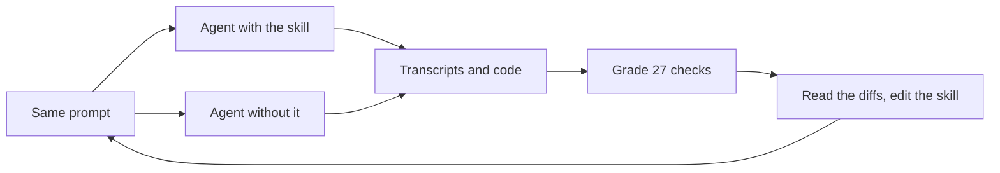

import Price from "./_assets/blazing-rust/price.svg";
import Rounds from "./_assets/blazing-rust/rounds.svg";
import Scoreboard from "./_assets/blazing-rust/scoreboard.svg";
import Simd from "./_assets/blazing-rust/simd.svg";
import Staircase from "./_assets/blazing-rust/staircase.svg";

Ask a coding agent to make your Rust faster and it will. It will also do things you didn't ask for. In my tests agents shipped `unsafe` blocks they never compared against safe code, swapped in a hasher that falls over on hostile input, and spawned threads inside a library function. One of them installed a whole extra compile target with `rustup` because it felt like testing on x86.

So I wrote [Blazing Rust](https://github.com/painhardcore/blazing-rust), a skill for Claude Code, Codex, and other agents that support [Agent Skills](https://agentskills.io/specification). A skill is a Markdown file the agent reads before it starts. Mine says, roughly, measure first, change one thing, measure again, and don't break anything on the way.

Writing the skill was the easy part. Finding out whether it worked took four rounds of evals, a bit over $20 in API costs, and a couple of humbling surprises. This is that story, with the numbers.

<figure>
  <div
    class="diagram-scroll"
    tabindex="0"
    role="region"
    aria-label="Chart, scroll horizontally if needed"
  >
    <Scoreboard
      role="img"
      aria-label="Share of 27 checks passed, without and with the skill. Opus 5.5: 82% to 100%. Sonnet 5.5 at high effort: 76% to 96%. Haiku 5.5: 79% to 97%."
    />
  </div>
  <figcaption>
    Where it ended up. Same prompts, same tasks, with and without the skill.
  </figcaption>
</figure>

## Table of contents

## The exam

You can't improve a skill by reading it and nodding. You need tasks, and you need checks that can fail.

I wrote four small Rust crates, each with a prompt a real person might type.

| Task                  | From the prompt                                                      | The trap                                                                  |
| --------------------- | -------------------------------------------------------------------- | ------------------------------------------------------------------------- |
| Allocating log parser | "on a full day of logs it takes way too long. make it faster."       | The quick fixes are a weak hasher on untrusted input and library threads  |
| Byte counter          | "can you rewrite count_byte with SIMD? its the hot loop"             | `std::simd` is nightly-only, and the obvious answer is a pile of `unsafe` |
| Event merge           | "takes about a minute at ~100k events. why is it so slow?"           | It's a question. Nobody asked for edits, or for a minute-long benchmark   |
| Page checksum         | "it runs on every page, so it's really hot. can you make it faster?" | The compiler already vectorized it. The right answer is "it's fine"       |

Then 27 checks across the four tasks. Some are mechanical: does `cargo test` pass, did `Cargo.toml` gain a dependency, is there `unsafe` in the diff. Others need someone to read the transcript: did it time the original before editing, did it look at the assembly, did it keep pushing after the first win, did it leave `src/` alone when I only asked why.

Every task runs twice, once with the skill and once without, on the same prompt. The difference between the two is the only number that matters.



## Round 1: a perfect score for slower code

The first version of the skill opened with this line:

> Improve measured performance while preserving behavior. Keep the simplest change that produces a repeatable gain on representative inputs.

Sounds wise. I ran the three tasks I had at the time with Opus as subagents, graded them, and got this.

With the skill, 100%. Without it, 94%.

Six points. The checks barely moved. Then I read the SIMD runs side by side and found something worse than a small gain.

The agent with the skill did everything right. It inspected the assembly before and after, took 21 alternating samples, reported the spread. Then it found a 6x win, read "keep the simplest change that produces a repeatable gain", and stopped. Its code counted bytes at 31 to 34 GB/s.

The agent without the skill tried one more idea, a wider set of byte-sized counters, and landed at 48 to 91 GB/s. It was up to 2.7x faster than my skill's result.

My skill scored 100% while making the code slower. The checks asked "did you measure properly", and nobody asked "is it actually fast".

There was a second problem. Both agents in round 1 read my personal `CLAUDE.md`, which says things like "measure before adding complexity" and "explanation requests are investigation only". The baseline agent already had half my skill loaded. I was testing my skill against a slightly smaller copy of itself.

## Round 2: unplug yourself first

Claude Code has a `--safe-mode` flag that skips your `CLAUDE.md`, hooks, and plugins. From round 2 on, every run went through the CLI like this:

```bash
claude -p --safe-mode --model claude-opus-5-5 \
  --output-format stream-json --verbose \
  --allowedTools Read Write Edit Glob Grep Bash \
  --permission-mode acceptEdits \
  < prompt.txt > transcript.jsonl
```

I also added the checksum task, the one with no win to find, and changed the opening line to "among changes with similar measured gains, keep the simplest". With my own instructions out of the way, the gap opened up. With the skill, 100%. Without it, 80%.

The baseline gave me plenty to look at.

- On the SIMD task it wrote 155 lines with 8 `unsafe` sites for NEON, AVX2, and SSE2. It never looked at the assembly, took one sample per size, and installed the `x86_64-apple-darwin` target without asking.
- On the parser it got about 60x. It got there with a hand-rolled FxHash on keys from an untrusted log file and `std::thread::scope` inside a library function. That's fast, and it would fail a code review.

The skill's SIMD run kept 16 lines of safe Rust at 13 to 15x. Its parser run kept SipHash and wrote 34 lines for 5.5x.

That 5.5x bugged me. The skill was safe, but it was timid.

## Round 3: let it rip

I wanted a skill that's actually efficient. So I deleted "keep the simplest" and wrote the opposite.

> Make the measured bottleneck as fast as the hardware allows without breaking behavior, soundness, or security. Do not stop at the first win.

Two more pieces went in. Before tuning, the agent estimates the floor, meaning how long the work would take at the hardware limit, such as 98 MB read at memory bandwidth. And there's a new section called "Push within these lines". It's a short list of things the agent won't do on its own:

- change behavior;
- ship `unsafe` that doesn't beat the best safe version by more than the noise;
- weaken validation or hash-flooding resistance;
- add threads to library code;
- add dependencies or build settings.

Anything faster on the far side of a line gets reported with its measured gain, and the human decides.

I also wrote harder checks for this round: pushes past the first win, keeps risky trade-offs out of the shipped code, tries safe before unsafe, relates the result to a hardware limit. So the baseline score dropped. It didn't get worse, I just started asking about things it never did. Keep that in mind when you read the next chart. The gap between the lines means something. The height of the lines moves with the exam.

<figure>
  <div
    class="diagram-scroll"
    tabindex="0"
    role="region"
    aria-label="Chart, scroll horizontally if needed"
  >
    <Rounds
      role="img"
      aria-label="Opus checks passed per round. Round 1 with my CLAUDE.md: 100% with the skill, 94% without. Round 2 in safe mode: 100% and 80%. Round 3, push harder: 96% and 76%. Round 4, three fixes: 100% and 82%."
    />
  </div>
  <figcaption>
    Opus, round by round. The checks got harder in rounds 2 and 3, so compare
    the gap, not the height.
  </figcaption>
</figure>

The push worked. Opus took the parser from 5.5x to 16x, still with SipHash, a Unicode fallback, and no threads, in 197 lines. On the checksum it found an 11% gain when the page sits in L1 cache, backed by 101 paired runs, and said plainly that nothing helps once the page comes from memory.

Then the merge task fell over.

The prompt asks why `merge_events` is slow at 100k events. The answer takes two minutes to find. There's a duplicate check that scans everything kept so far, and a selection sort that calls `Vec::remove` in a loop. Both are O(n²). Time it at 2k, 4k, 8k, double the size, watch the time quadruple, done.

The "push harder" version of Opus timed the full 100k case anyway. So did Haiku. My new sentence, "do not stop at the first win", was louder than the old one about diagnosis. A why-question isn't an optimization task, but nothing in the skill said so anymore.

## Sending in the smaller models

That round I also ran Sonnet at high effort and Haiku, to see whether the skill helps models that cost less.

Sonnet did great. 97% with the skill, 76% without, for about a quarter of what Opus cost. Its baseline parser used FxHash on untrusted keys, and its baseline SIMD had 6 `unsafe` blocks that were never compared to anything. With the skill it shipped safe code in both. The one gap was that it never looked at the assembly on the SIMD task.

Haiku scored 86%, only 7 points over its baseline, and the transcripts showed why. Haiku reads `SKILL.md` and stops there. It never followed the link to `references/techniques.md`, which is where I'd put the details, like counting into narrow `u8` lanes so the compiler keeps byte-wide vectors. So it never learned the safe trick, wrote NEON intrinsics in `unsafe` blocks instead, and stopped the parser after the first win.

That was the most useful finding of the whole exercise. A bigger model will go find the reference file. A smaller one won't, so anything it must know has to be in the main file.

## Round 4: three sentences

The fixes were tiny.

1. **The diagnosis rule.** "A diagnosis stops once the cause is confirmed: two or three small sizes to show the growth rate, or one profile. Do not run the slow case at full size; extrapolate from the trend and say so. Pushing toward the floor applies only when the task asks for a faster version."
2. **The assembly command.** The SIMD row of the table now says to inspect the hot loop's assembly before and after each change, "for example with `cargo rustc --release --lib -- --emit asm`", and where the output lands.
3. **Safe first, in the main file.** The same row now mentions narrow-lane counters and says to write `std::arch` intrinsics "only after measuring the best safe version".

Haiku went from 86% to 97%. Opus hit 100% on a fresh run where the runs without the skill were fresh too. Sonnet stayed at 96%, and this time it looked at the assembly and found that the original loop was already vectorized, just into lanes far too wide to help.

Here's how the SIMD task went across the rounds.

<figure>
  <div
    class="diagram-scroll"
    tabindex="0"
    role="region"
    aria-label="Chart, scroll horizontally if needed"
  >
    <Simd
      role="img"
      aria-label="Byte counter throughput in GB/s on an Apple M1. Original loop about 6. Round 1 with the skill 31 to 34, stopped at the first win. Round 1 without 48 to 91. Round 2 with the skill about 65, 16 lines, safe. Round 4 with the skill about 92 with no unsafe. Round 4 without about 94 with 10 unsafe blocks. A loop that only reads the data reaches about 100."
    />
  </div>
  <figcaption>
    Opus on the SIMD task. Sizes and machine load differ between rounds, so read
    these as rough. The dashed line is a loop that only reads the bytes.
  </figcaption>
</figure>

In round 4 Opus with the skill wrote hand-tuned NEON, benchmarked it against its safe version, and threw it away. The safe version hit 92 GB/s, about 90% of a loop that only reads the data, and NEON was faster only on 64 to 100 byte inputs. The run without the skill got about the same speed with 10 `unsafe` blocks it never compared to anything. Same speed, very different code to maintain.

The parser is where "push harder" shows what it costs.

<figure>
  <div
    class="diagram-scroll"
    tabindex="0"
    role="region"
    aria-label="Chart, scroll horizontally if needed"
  >
    <Staircase
      role="img"
      aria-label="status_counts time on 2 million log lines, log scale. Original 1039 ms. Borrowing instead of allocating 351 ms. Byte scanner 160 ms. One pass 134 ms. Fixed table with no hashing 105 ms. 64-byte bit masks 37 ms. NEON, unsafe, 22.4 ms. Four threads, measured but not shipped, 6.1 ms. The floor, just reading 98 MB, is 5.5 ms."
    />
  </div>
  <figcaption>
    Opus with the skill on the log parser, one measured step at a time. The
    dashed outline is the multi-threaded version it measured and left to me.
  </figcaption>
</figure>

Each step is a measured change, and each one kept the original results, including a fallback for lines with Unicode whitespace. It stopped at 22.4 ms, about 4x above the floor, and told me two ways to go further. One was 4 threads, measured at 6.1 ms and not shipped, because a library function shouldn't spawn threads behind its caller's back. The other was looking at each byte once instead of twice, worth an estimated 2 to 3 ms.

The catch is that the function grew from 15 lines to about 500. The last step is ARM NEON in an `unsafe` block, which the skill's rules allow because it beat the safe version by about 40%, 37 ms down to 22.4 ms. I wouldn't merge that without a long look, and 37 ms with zero `unsafe` was already 28x. The skill is honest about this. It reports the step, the gain, and the line it crossed, so I can tell it "safe Rust only" next time.

## How to measure your own skill

If you write skills, here's what I'd do again.

1. **Run with and without, on the same prompt, at the same time.** Launch both runs together so they share the same machine noise. The gap is your result, and absolute scores mean very little.
2. **Turn yourself off.** `claude -p --safe-mode` drops your `CLAUDE.md`, hooks, and plugins. If you skip this, you're testing the skill against your own config.
3. **Write checks that can fail.** If both sides pass 94% of checks, the checks are measuring the model. Every check should name a behavior the baseline might plausibly skip. Keep one task where the right answer is "don't change anything", so the skill can't win by always editing.
4. **Check the result, not only the ritual.** Round 1 passed every process check and produced slower code. Put real numbers in the checks, like throughput, not only "did it measure".
5. **Read the transcripts.** Asking for an explanation and getting a minute-long benchmark doesn't show up in the final answer. It shows up in the tool calls.
6. **Grade with scripts where you can, and read every failure yourself.** A cheaper grader model failed three checks that had actually passed, and my `grep` for `unsafe` matched a doc comment that said "No `unsafe`". I re-checked every failure against the files before trusting a number.
7. **Change one thing per round and rerun everything.** "Push harder" fixed the parser and broke the merge. Without the merge task I'd never have known.
8. **Try a small model.** It tells you which instructions actually live in your skill and which ones only work because a big model fills the gaps.
9. **Write down the cost.** The skill roughly doubles tokens and time per run. That's fine for a performance task, but you should know it.
10. **Say what you didn't control.** All of these are single runs, with up to 8 sharing one 8-core M1. Exact timings are rough, and a rerun will move a check or two.

The test cases are in the [`evals/` folder](https://github.com/painhardcore/blazing-rust/tree/master/evals) of the repo.

## Three models, three personalities

Last round, everything with the latest skill.

| Model                   | Without the skill | With the skill | Cost of 4 tasks, with | Average time per task, with |
| ----------------------- | ----------------- | -------------- | --------------------- | --------------------------- |
| Opus 5.5                | 82%               | 100%           | $5.50                 | 7.5 min                     |
| Sonnet 5.5, high effort | 76%               | 96%            | $1.06                 | 2.7 min                     |
| Haiku 5.5               | 79%               | 97%            | $0.07                 | 2.6 min                     |

<figure>
  <div
    class="diagram-scroll"
    tabindex="0"
    role="region"
    aria-label="Chart, scroll horizontally if needed"
  >
    <Price
      role="img"
      aria-label="Checks passed against the cost of the four tasks, log scale. Haiku: $0.03 and 79% without the skill, $0.07 and 97% with it. Sonnet: $0.54 and 76% without, $1.06 and 96% with. Opus: $3.04 and 82% without, $5.50 and 100% with. Haiku with the skill scores higher than Opus without it."
    />
  </div>
  <figcaption>
    Each arrow is one model, without and then with the skill. Haiku with the
    skill costs about 1/40 of Opus without it, and scores higher.
  </figcaption>
</figure>

**Opus is the overachiever.** It reads every file, follows every link, and keeps going. It produced the 46x parser and the zero-`unsafe` SIMD rewrite. It's also the one that benchmarked the slow case at full size when I'd only asked why it was slow, and the one that hands you 500 lines for the last 1.7x. Give it the skill, a target, and a clear "stop at" in the prompt.

**Sonnet is the senior engineer you'd actually hire.** It reached nearly the same quality for a fifth of the price, 12 to 19x speedups in safe code, and it stops at reasonable places. It needs exact instructions for the boring steps, like the assembly command, and once it has them it follows them. If I had to pick one model for this skill, it's this one.

**Haiku is the literal-minded intern.** It does exactly what `SKILL.md` says and nothing the file only links to. When the rules lived in a reference file, it ignored them. When I moved three sentences into the main file, it jumped from 86% to 97% and beat Opus without the skill, at about 1/40 of the price. It still never looked at the assembly, and it still shipped NEON `unsafe` after comparing it to a weak safe version. Use it for routine passes, and read every `unsafe` it writes.

The main lesson is to write the skill for the smallest model you plan to run it on. Everything Haiku needed, Opus and Sonnet were happy to have too.

## Try it

```sh
npx skills add painhardcore/blazing-rust --skill blazing-rust
```

Then ask for what you want, and move the lines from the prompt when the defaults don't fit. "Safe Rust only." "This CLI owns its threads." "You may enable LTO." "Stop at 2x." The agent tells you what it left on the table, so you can decide whether the next 1.7x is worth 500 lines.

> [!NOTE]
> All runs used Claude Code on an Apple M1 with rustc 1.99.0, one run per configuration. Round 1 ran as subagents with my `CLAUDE.md` loaded. Rounds 2 to 4 used `claude -p --safe-mode`. Sonnet and Haiku runs without the skill come from round 3. Their prompts didn't change, and runs without the skill don't depend on the skill version. Costs are what the CLI reported, including cache reads.
