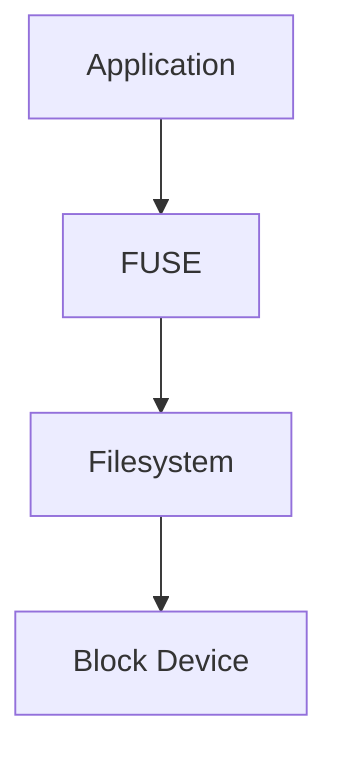
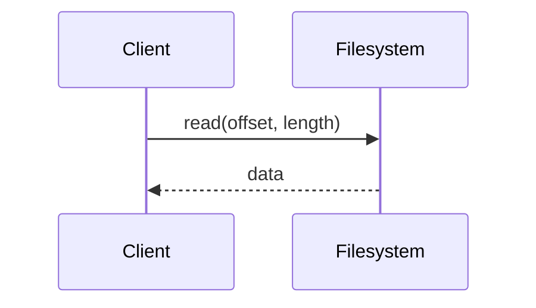
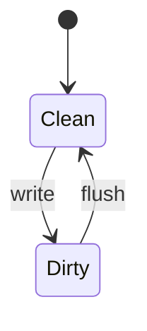
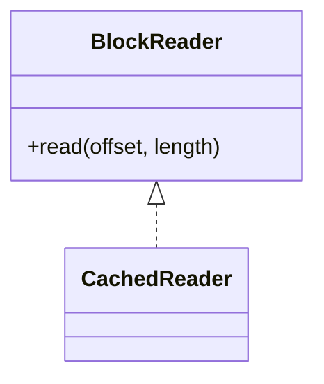
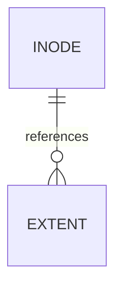

import ResponsiveTable from "@/components/ResponsiveTable.astro";
import storagePath from "./_assets/storage-path.svg?url";

> [!NOTE]
> This is a demonstration of the blog's authoring features. It contains no
> research findings or measured benchmark results. Keep `draft: true`.

## Table of contents

## Source code

Rust with line highlighting, word highlighting, and a filename:

```rust {2} /capacity/ file=buffer.rs
fn main() {
    let capacity = 4096;
    let buffer = vec![0_u8; capacity];
    println!("{} bytes", buffer.len());
}
```

Go with a highlighted line and diff annotations:

```go file=main.go
package main

import "fmt"

func main() {
    size := 4096 // [!code --]
    size := 8192 // [!code ++]
    fmt.Println(size) // [!code highlight]
}
```

The diff block illustrates an edit; apply the additions and remove the deletions
before compiling. Code blocks scroll horizontally and include copy buttons.

## Diagrams

Use `accTitle` and `accDescr` to describe each diagram for screen readers.



### Sequence



### State



### Classes



### Entities



## Equations

Inline mathematics: a block contains $2^{12} = 4096$ bytes.

$$
\text{Write Amplification}
=
\frac{\text{Physical Bytes Written}}{\text{Logical Bytes Written}}
$$

This is a definition, not a measured result.[^measurement]

## Benchmark tables

Record the workload and environment alongside any measurements. This table is
an unfilled recording template. The dashes mean no measurement was taken.

| Workload        | Block size | Throughput | p99 latency | Environment  |
| :-------------- | ---------: | ---------: | ----------: | :----------- |
| Sequential read |      4 KiB |          — |           — | Not measured |
| Random write    |      4 KiB |          — |           — | Not measured |

MDX can also use the theme's existing table component:

<ResponsiveTable variant="striped">

| Field       | Description                                             |
| :---------- | :------------------------------------------------------ |
| Workload    | Include access pattern and concurrency                  |
| Environment | Include hardware, OS, filesystem, and software versions |

</ResponsiveTable>

## Figures

<figure>
  
  <figcaption>
    A conceptual storage path, with no performance claims.
  </figcaption>
</figure>

## Notes and links

> [!WARNING]
> Validate benchmark methodology and record the environment before publishing
> measurements.

> Simplicity makes it easier to inspect assumptions.

See the [About page](/about/) or the
[Linux kernel documentation](https://docs.kernel.org/).
Link to a published article with `/posts/article-slug/`. Filenames determine
stable URLs independently of publication dates.

[^measurement]:
    Real results need a reproducible workload, system configuration,
    and an explanation of what the measurement includes.
