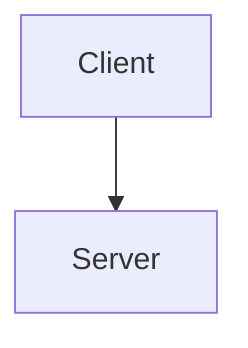
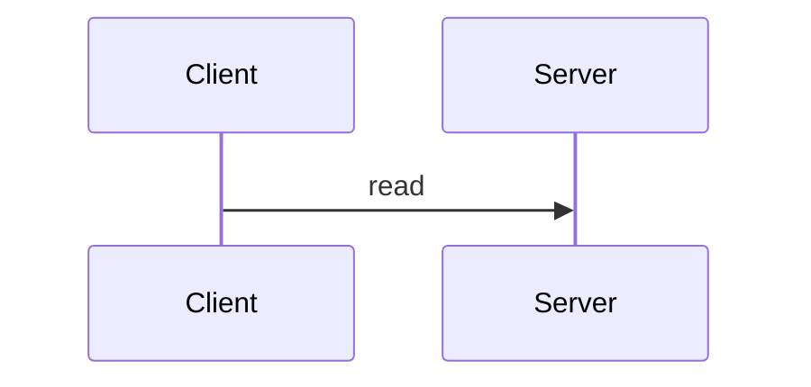
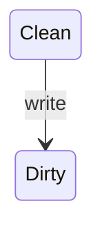
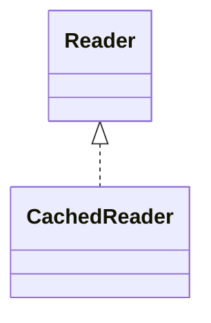
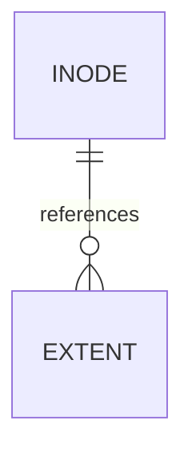

import ResponsiveTable from "@/components/ResponsiveTable.astro";

## Table of contents

## Source code

```rust {2} /capacity/
fn main() {
    let capacity = 4096;
}
```

```go
size := 4096 // [!code --]
size := 8192 // [!code ++]
```

## Diagrams











## Math and tables

Inline $x^2$ and a block equation:

$$
\frac{a}{b}
$$

<ResponsiveTable>

| Input | Output |
| ----- | ------ |
| a     | b      |

</ResponsiveTable>

> [!NOTE]
> Fixture callout.[^fixture]

<figure>
  
  <figcaption>Fixture caption</figcaption>
</figure>

[^fixture]: Fixture footnote.
